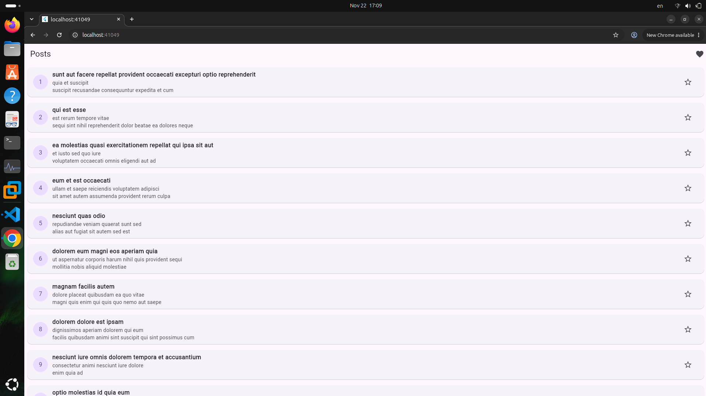
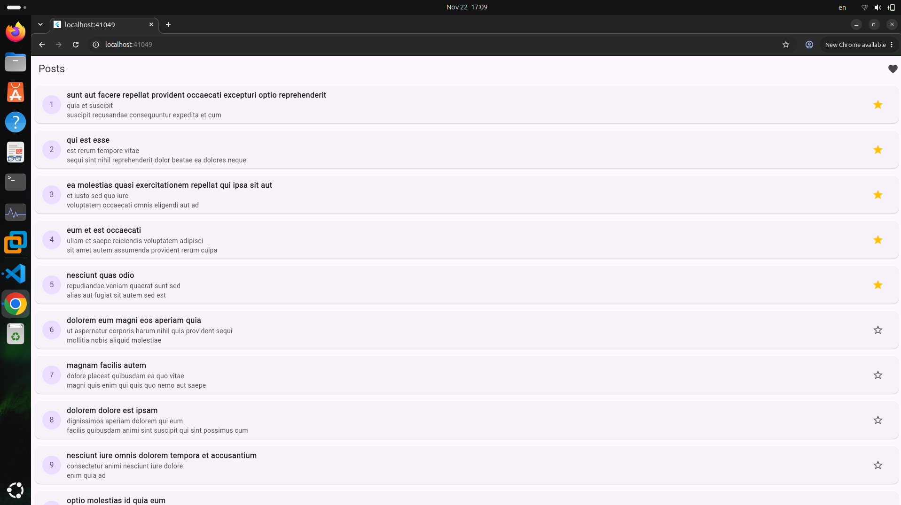
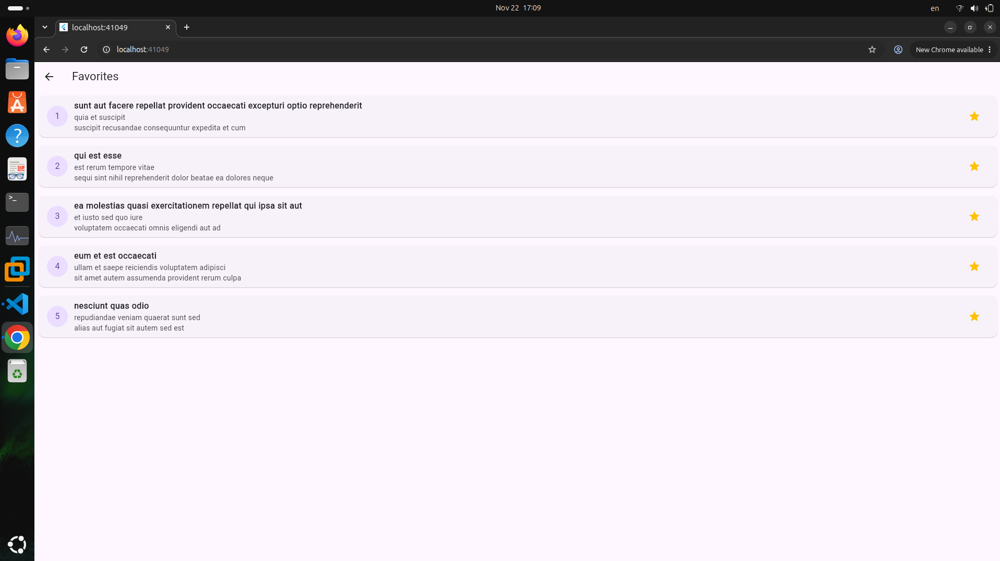
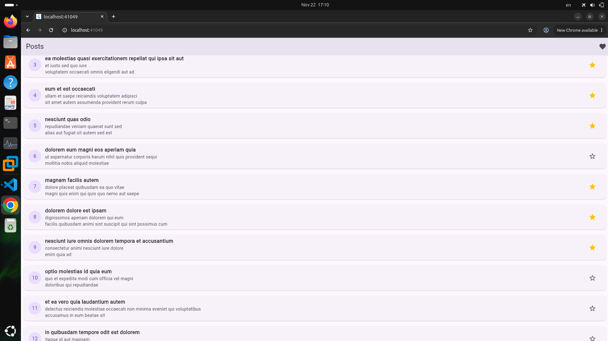
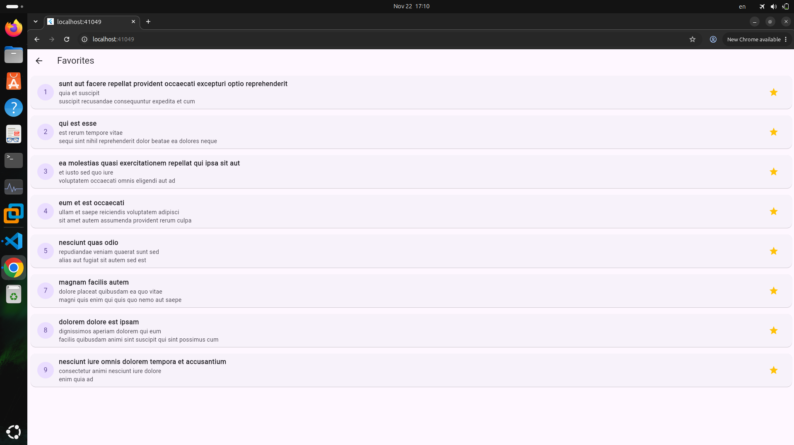
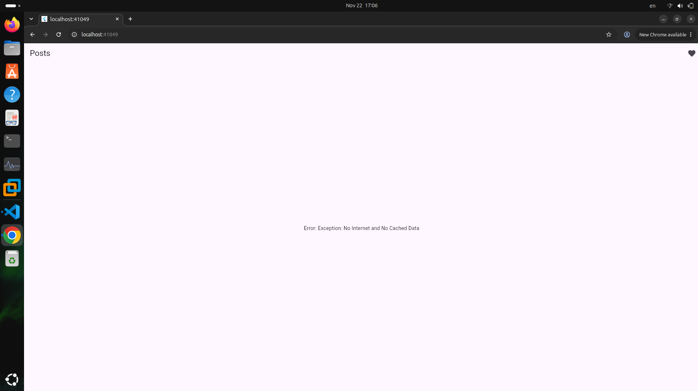

# Offline Posts App with Favorites

## Overview

A Flutter app that shows posts from the [JSONPlaceholder API](https://jsonplaceholder.typicode.com/posts) and stores them locally with **Hive**, a lightweight NoSQL database written in pure Dart. The app keeps working without internet by showing the last saved data. Users can also mark posts as **favorites**, which are saved in their own Hive box so they survive refreshes and app restarts.


## Project Structure

```
lib/
├── main.dart                     # initialises Hive, registers the adapter, opens boxes
├── models/
│   ├── post_model.dart           # Post class + Hive annotations
│   └── post_model.g.dart         # generated Hive adapter
├── services/
│   ├── post_service.dart         # API + Hive logic (data layer)
│   └── favorites_service.dart    # favorites logic (NEW)
└── screens/
    ├── posts_screen.dart         # posts list with star buttons (UPDATED)
    └── favorites_screen.dart     # favorites list (NEW)
```

## How It Works

### Data flow

```
INTERNET → API → Hive → ListView
```

`PostService.getPosts()` works like this:

1. Open `postsBox`.
2. Try to fetch the posts from the API.
3. On success: clear the box, save the new posts, and return them.
4. On failure: if the box has data, return it. Otherwise throw "No Internet and No Cached Data".

The screens never call `http` or Hive directly for posts. They only ask the service for data.

### Favorites

`FavoritesService` provides three methods:

| Method | What it does |
|---|---|
| `toggleFavorite(Post post)` | Adds the post to `favoritesBox` if it is not there, removes it otherwise |
| `isFavorite(int id)` | Returns `true` if a post with this id is in `favoritesBox` |
| `getFavorites()` | Returns all saved favorite posts |

Design decisions:

- **A separate box:** `getPosts()` calls `postsBox.clear()` on every refresh, which would wipe favorites if they were stored there. `favoritesBox` is never cleared by a refresh.
- **The post id is the key:** `box.put(post.id, copy)` makes `containsKey(id)` and `delete(id)` simple and fast.
- **A copy of the Post is saved:** a `HiveObject` can only live in one box at a time, so putting the same instance in both boxes throws an error. A new `Post` is created from the same values instead.
- **Instant UI updates:** `ValueListenableBuilder` listens to `favoritesBox`, so stars and the Favorites screen rebuild automatically whenever it changes.


Dependencies (`pubspec.yaml`): `http`, `hive`, `hive_flutter`, `connectivity_plus`; dev dependencies: `hive_generator`, `build_runner`.

## How to Test Offline Mode

 Reopening the app after being in airplane mode the posts load from Hive ("Loaded from Hive offline" in the console) and the favorites are still there.

## Screenshots

### 1. Posts loaded from the API


### 2. Marking posts as favorites (filled star)


### 3. Favorites screen


### 4. Empty favorites state ("No favorites yet")


### 5. Offline mode: posts loaded from Hive


### 6. Offline mode: favorites still saved after restart



### 7. Offline mode: posts screen when offline and no cache


## Technologies

Flutter, Dart, Hive, hive_flutter, http
